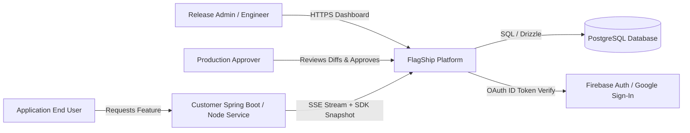
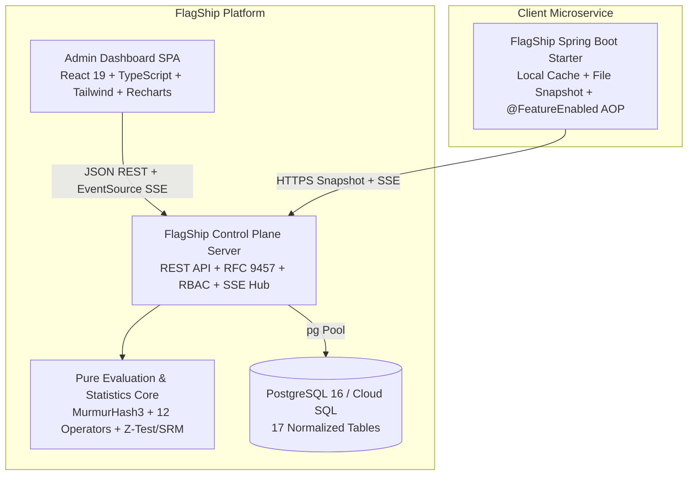
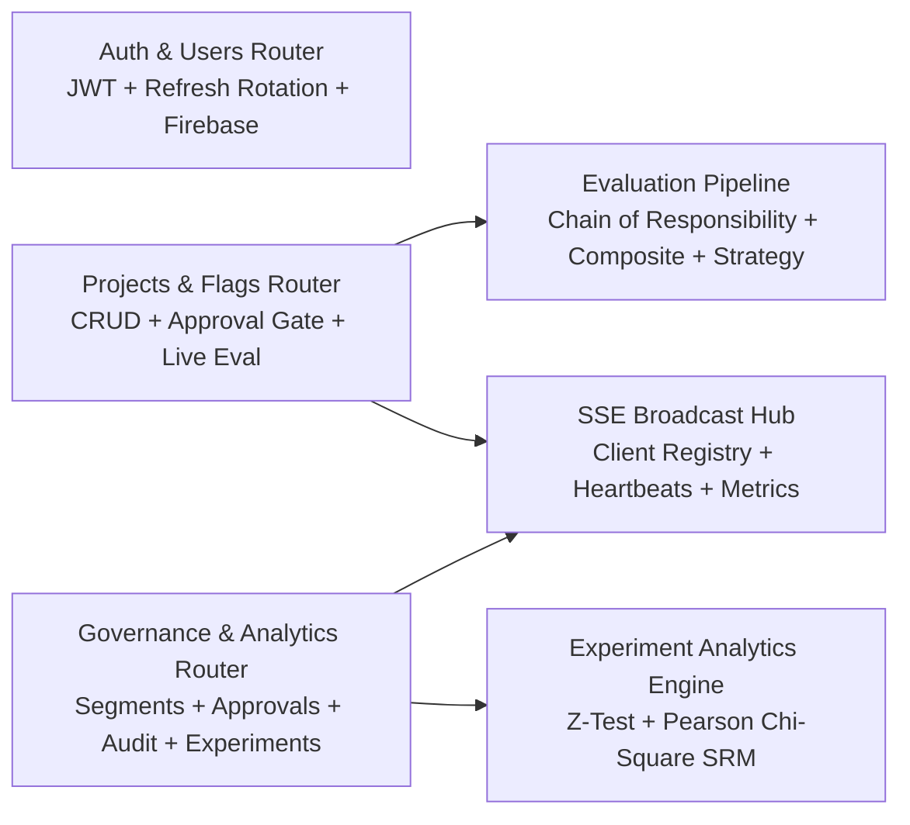
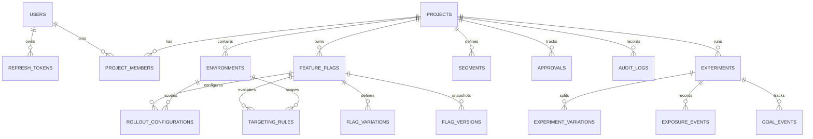

# FlagShip — Architecture Documentation

## 1. C4 Context Diagram

## 2. C4 Container Diagram

## 3. C4 Component Diagram (Control Plane)

## 4. Database ER Diagram (17 Normalized Tables)

## 5. Design Pattern Justification Table

| Pattern | Where Implemented | Architectural Justification |
|---|---|---|
| **Chain of Responsibility** | `src/core/evaluator.ts` (`evaluateFlag`) | Enforces exact 5-stage precedence (Kill Switch -> Individual Target -> Segment/Rules -> Percentage Rollout -> Default) with clean short-circuiting. |
| **Strategy** | `src/core/evaluator.ts` (`operatorStrategies`) | Encapsulates all 12 comparison operators (`EQUALS` through `DATE_AFTER`) behind a uniform `(attrVal, target) => boolean` contract, enabling O(1) lookup without giant switch blocks. |
| **Composite** | `src/core/evaluator.ts` (`evaluateRuleGroup`) | Models arbitrarily nested `AND` / `OR` rule groups and leaf conditions uniformly via recursive tree evaluation. |
| **Observer (Pub/Sub)** | `src/server/sse.ts` (`ObservabilityAndStreamHub`) | Decouples flag mutation routes from connected dashboard and SDK SSE streams so kill-switch updates fan out automatically. |
| **Proxy / Decorator (AOP)** | `FeatureEnabledAspect.java` | Intercepts `@FeatureEnabled` methods transparently without polluting business services with flag lookup boilerplate. |
| **Builder / Immutable Snapshot** | `buildFlagSnapshot`, `flag_versions` | Assembles self-contained, immutable flag snapshots for both SDK offline caching and version restoration. |
| **Command (Staged Mutation)** | `approvals` (`proposedChanges` + `decision`) | Serializes proposed production mutations as reviewable command payloads that execute atomically only after two-person quorum. |

### Singleton Decision Documentation
- **PostgreSQL Pool (`src/db/index.ts`)**: Singleton cached on `global._postgresPool` to prevent connection exhaustion across reloads and stay within the 10-connection pool budget.
- **SSE Hub (`src/server/sse.ts`)**: Single process-scoped registry (`streamHub`) holds live `EventSource` response handles. For horizontal multi-instance scaling, this hub can be backed by PostgreSQL `LISTEN/NOTIFY` or Redis Pub/Sub without altering route callers.
- **Avoided Global Mutable Flag State**: Flag configurations are never stored as mutable singletons on the backend; PostgreSQL is always the source of truth, while SDK clients swap immutable `AtomicReference<JsonNode>` snapshots atomically.

## 6. Quality Attribute Utility Tree (6 Scenarios)

| Quality Attribute | Refinement | Scenario | Target Measure |
|---|---|---|---|
| **Performance** | Local Evaluation Latency | Client SDK evaluates a flag with 10 targeting rules locally under load. | **QA1**: p99 <= 50 µs (Measured: **27.456 µs**). |
| **Resource Efficiency** | Client Memory Footprint | Client SDK caches 1,000 active flags with rules in heap. | **QA1**: <= 20 MB heap delta (Measured: **1.163 MB**). |
| **Availability** | Offline Resilience | Control plane experiences 30-minute outage; client service continues serving traffic or restarts. | **QA2**: 0 business exceptions; startup <= 2s using local snapshot. |
| **Responsiveness** | Kill-Switch Propagation | Admin activates emergency kill switch in Production. | **QA3**: p95 propagation <= 5 seconds to connected SSE instances. |
| **Correctness** | Rollout Determinism | Rollout expands from 10% to 20% across 1,000,000 users across server preview & starter. | **QA4**: 100% parity & 100% retention of initial 10% cohort (Measured: **100.0000%**). |
| **Usability / Integrability** | Developer Onboarding | New Java developer integrates Spring Boot Starter into a fresh app. | **QA5**: Complete working `@FeatureEnabled` integration in <= 15 minutes. |

## 7. Mini-ATAM Sensitivity & Trade-Off Analysis

- **Sensitivity Point 1 (Local Snapshot Evaluation vs. Server-Side Evaluation)**: Evaluating flags in-process achieves sub-30 µs latency and full offline resilience, but introduces brief eventual consistency (sub-second via SSE, up to `pollIntervalMs` if SSE drops).
- **Sensitivity Point 2 (Emergency Kill Switch Bypassing 2-Person Approval)**: Production changes require 2-person approval to prevent accidental blasts, **except** emergency kill-switch activation, which executes immediately and broadcasts via SSE. Trade-off: prioritizes incident MTTR over governance ceremony on kill-switch activation, while recording an immutable audit entry and requiring approval to re-enable.
- **Sensitivity Point 3 (MurmurHash3_32 vs. Cryptographic SHA-256)**: MurmurHash3_32 runs in ~1.4 µs per user key with uniform distribution across 1,000,000 users and tiny cross-language code size (TypeScript + Java parity), trading cryptographic non-invertibility (unnecessary for bucketing) for speed.
